# 08-框架全景流程与发布核对清单

> 本文档面向所有使用与维护本框架的工程师、算法研究员与 AI 智能体。
> 包含两项核心使命：
> 1. **全景认知**：向使用者完整展示框架端到端生命周期工作流与核心能力体系；
> 2. **标准核对规程**：在**更新模型/框架版本之前**以及**正式向平台发布上线之前**，提供可逐项打勾执行的标准核对清单（Checklist）。

---

## 一、框架核心功能矩阵

本框架面向高可靠工业水务场景设计，为算法模型从离线研发到工业级上线提供全生命周期工程约束与质量防护：

| 功能模块 | 核心能力 | 对应工具 / 载体 | 核心价值 |
|---|---|---|---|
| **脚手架与生命周期** | 标准化创建、演进与版本分叉 | `model-lab new` / `maintain` / `draft-fork` / `advance` | 消除手工复制代码模板引发的错误，强制状态单向递进 |
| **契约驱动规格** | 输入输出签名、时间粒度与点位强绑定 | `model.yaml` / `input-bindings.yaml` / `model-spec.md` | 接口契约化，消除算法特征与底层数据流的歧义 |
| **四道质量硬门禁** | 环境、目录、快照与制品全维度自动化核验 | `doctor` / `catalog` / `context` / `release-gate` | 离线确定性防御，杜绝坏味道代码与不合规模型进入仓库 |
| **双运行时解耦** | 本地 Windows 开发控制面 + Linux 生产执行实包 | `bundle-build` / `bundle-preflight` / WSL (Ubuntu) | 在本地即可完全复刻云端 Linux 生产环境并跑通预测 |
| **智能体协同矩阵** | 7 大生命周期专用技能与双轴代码审查 | `.skillshare/` 技能库 + Standards / Spec 双轴审查 | 规范人机协作边界，提供确定性的引导与自动化守护 |
| **安全分发与脱敏隔离** | 通用框架代码与私有业务模型物理隔离 | `model-lab distribute` + 隐私门禁扫描 | 保证开源框架通用性，同时彻底杜绝业务敏感信息泄露 |

---

## 二、框架全景生命周期工作流



> 💡 **架构设计图元与交互说明**：本图基于 `diagram-design` 架构设计体系绘制，包含 Windows 开发控制面、Linux WSL 隔离实包构建执行面与四大质量硬门禁防护层。完整交互式网页版本见 [framework-architecture-and-lifecycle.html](diagrams/framework-architecture-and-lifecycle.html)。

每个水务模型都必须严格遵循 **六阶段状态机**，不可跨阶段跃迁：

```text
 ┌───────────────┐
 │   Stage 0     │ 环境准备与引导 (Setup & Doctor)
 │   Bootstrap   │ -> 运行 model-lab-setup 自检，确认 Python 3.11 与构建环境
 └───────┬───────┘
         ▼
 ┌───────────────┐
 │   Stage 1     │ 契约与规格设计 (Draft -> Specified)
 │   Contract    │ -> model-lab new 生成草稿，定义 model.yaml 与 input-bindings.yaml
 └───────┬───────┘
         ▼
 ┌───────────────┐
 │   Stage 2     │ 算法研发与验证 (Specified -> Built -> Validated)
 │  Development  │ -> 实现 src/model.py，编写单测与 Notebook，产出 plots 与报告
 └───────┬───────┘
         ▼
 ┌───────────────┐
 │   Stage 3     │ 目标环境实包构建 (Validated -> Releasable)
 │   Packaging   │ -> 目标 Linux Python 3.11 构建 release-bundle/service 并完成预测核验
 └───────┬───────┘
         ▼
 ┌───────────────┐
 │   Stage 4     │ 全量门禁与版本核对 (Pre-Release Audit)
 │   Auditing    │ -> 跑通四道门禁 + 全量回归 + 补充 CHANGELOG.md + 双轴代码审查
 └───────┬───────┘
         ▼
 ┌───────────────┐
 │   Stage 5     │ 显式授权发布与留档 (Releasable -> Released)
 │  Publication  │ -> 获得用户逐次授权，执行 publish --apply，生成 MLflow 回执
 └───────────────┘
```

### 各阶段输入、产出与推进命令对照

| 阶段 | 初始状态 | 目标状态 | 核心任务 | 关键产出文件 | 推进命令 / 门禁 |
|---|---|---|---|---|---|
| **0. 自检** | - | READY | 检查 Python 3.11 控制面、技能与 Linux 构建环境 | `.model-lab.local.json` | `python -m model_lab doctor .` |
| **1. 设计** | `draft` | `specified` | 明确业务诉求、点位映射与算法输入输出契约 | `model.yaml`, `input-bindings.yaml`, `decisions.yaml` | `model-lab advance <path> --apply` |
| **2. 研发** | `specified` | `built` / `validated` | 编写模型算法源码、高精基准测试与可视化审查 | `src/model.py`, `tests/test_model.py`, `plots/*.png` | `advance --apply`（需单测与证据全过） |
| **3. 打包** | `validated` | `releasable` | 在 Linux 3.11 构建自包含 MLflow 服务实包并预检 | `release-bundle/service/`, `preflight.json` | `bundle-build` + `bundle-preflight` + `advance --apply` |
| **4. 审计** | `releasable` | 门禁就绪 | 跨平台回归测试、更新变更记录、通过四道门禁 | `CHANGELOG.md`, `git diff` | 四道硬门禁全通过 + 双轴审查 PASS |
| **5. 发布** | `releasable` | `released` | 获得明确授权后，将制品上传并留存发布回执 | `publish-receipt.json`, MLflow 平台 Run | `publish --apply`（必须用户显式授权） |

---

## 三、更新版本之前核对规程（Pre-Update Checklist）

无论对模型做版本升级（如 `0.1.0` -> `0.2.0` / `1.0.0`），还是迭代通用框架底层代码，在**合并代码或提交版本变更前**，必须逐项核对：

### 1. 契约与接口核对
- [ ] **语义化版本号合规**：
  - 补丁修复（Bugfix / 平台行为不变）：增加 Patch 版本号（如 `1.0.0` -> `1.0.1`）；
  - 测点增加 / 功能扩展（向后兼容）：增加 Minor 版本号（如 `1.0.0` -> `1.1.0`）；
  - 签名破坏 / 算法输入输出重构：增加 Major 版本号（如 `1.0.0` -> `2.0.0`）。
- [ ] **元数据清单与输入绑定对齐**：
  - `model.yaml` 中的输入输出字段名、类型与 `input-bindings.yaml` 100% 一致；
  - 点位聚合规则（如双探头 `mean`、单探头 `latest`、流量 `diff`）明确标注且经业务确认。
- [ ] **决策记录无悬挂**：
  - `decisions.yaml` 中的所有必填决策项（`CONFIRM`）均已标记为 `confirmed` 并附带确认人，无遗留未决项。
- [ ] **文件摘要钉住（SHA256 Pinning）**：
  - `model.yaml` 中的 `source.entrypoint`、`source.notebook`、`source.specification` 的 `digest_sha256` 已重新计算并更新为最新的 `utf8-lf` 哈希。

### 2. 代码与环境纯洁性核对
- [ ] **Python 3.11 绝对基线**：
  - 全仓所有执行链路与虚拟环境均为 Python 3.11（推荐 3.11.15），无任何 Python 3.12 专属语法或隐式依赖。
- [ ] **零污损工作树**：
  - 工作区不包含任何未纳管的临时测试表格（如 `benchmark.csv` 等），禁止私自将原始数据带入 Git；
  - 模型草稿目录下绝无 `__pycache__` 或 `.pytest_cache` 目录（可运行清理命令 `Get-ChildItem -Path models -Filter __pycache__ -Recurse | Remove-Item -Recurse -Force`）；
  - 本地历史资产模型目录下的 `*.pkl` 真实权重文件保持不动，不破坏原状。
- [ ] **无凭据与隐私保护**：
  - 源码、注释、Notebook 与文档中严禁包含数据库密码、平台 Token、真实内网 IP 或未经许可的敏感信息。

### 3. 自动化测试核对
- [ ] **领域模型测试全绿**：
  - 模型的单元测试继承标准 `unittest.TestCase`，所有测试用例通过（OK）；
  - 现场实测基准数据与算法输出浮点误差小于 $10^{-8}$。
- [ ] **可视化图表规范**：
  - 生成的图表（`plots/*.png`）全部使用全英文坐标轴与图例，无中文方框乱码（□□□□），画面无视觉遮挡。

---

## 四、发布上线时硬核对规程（Pre-Release Checklist）

在正式执行部署上传（向 MLflow 发布实包）或合并 PR 发布正式 Release 前，必须执行以下终极验收：

### 1. 四道硬门禁全绿（Mandatory Four Gates）

必须在 PowerShell 中逐条运行下列命令，且全部返回 PASSED / 退出码 0：

```powershell
# 门禁 1：环境控制面体检 (必须显示 READY)
.\.venv-311\Scripts\python.exe -m model_lab doctor .

# 门禁 2：中央资产目录一致性检查 (必须显示 IN SYNC，无任何元数据漂移)
.\.venv-311\Scripts\python.exe -m model_lab catalog models --expected-count 8 --check docs/00-入口层/01-在役模型资产目录.md

# 门禁 3：全仓模型工作流快照检查 (退出码必须为 0)
.\.venv-311\Scripts\python.exe -m model_lab context --all --check

# 门禁 4：第一阶段发布门禁总合闸 (8 项规则必须全过，valid: true)
.\.venv-311\Scripts\python.exe -m model_lab release-gate .
```

- [ ] **Gate 1 (Doctor)**：READY（Python 3.11 环境与 CLI 就绪）
- [ ] **Gate 2 (Catalog)**：IN SYNC（8 个在役资产目录与底层清单完全对齐）
- [ ] **Gate 3 (Context)**：Exit 0（状态快照无任何未同步漂移）
- [ ] **Gate 4 (Release Gate)**：8 项检查全部通过（包含 `asset_catalog`、`draft_inventory`、`catalog_output`、`behavior_baseline`、`chronos_contract`、`publish_preview`、`git_history`、`release_metadata`）

### 2. 真实目标环境（Linux Python 3.11）实包验证
- [ ] **独立实包构建**：
  - 在 WSL (Ubuntu) 或 Linux 容器的 Python 3.11 环境中运行 `model-lab bundle-build <model.yaml> --sample-csv <data.csv> --apply`，成功生成脱敏自包含的 `release-bundle/service/`。
- [ ] **静态预检通过**：
  - 运行 `model-lab bundle-preflight <model.yaml>`，通过 conda 环境依赖、Python 版本与 MLmodel 配置检查。
- [ ] **真实回载推理冒烟**：
  - 在 Linux 隔离环境中通过 `mlflow.pyfunc.load_model("release-bundle/service")` 成功加载实包；
  - 传入全点位模拟真实输入数据调用 `loaded.predict(df)`，返回的特征预测值维度完整、指标数值物理合理。

### 3. 代码审查与变更追踪
- [ ] **双轴代码审查双 PASS**：
  - **Standards 轴**：代码结构、类型注解、异常防御、无坏味道，符合仓库既有风格；
  - **Spec 轴**：与业务需求规格、公式参数、现场点位表 100% 对齐，无伪造与假实现。
- [ ] **CHANGELOG.md 真实对齐**：
  - 在 `CHANGELOG.md` 中以真实提交、关联 Issue/PR 和技术点记录本次发布内容。
- [ ] **仓库布局守卫通过**：
  - 运行 `python -m unittest tests/test_repository_layout.py`（全部用例通过）。
- [ ] **全量回归测试完成**：
  - 运行全量测试套件 `python -m unittest discover -s tests`，所有用例通过（0 failure, 0 error）。

### 4. 发布操作安全边界与授权红线
- [ ] **Git 工作树干净**：
  - `git status` 确认无任何未提交的修改或未追踪的文件；
  - 本地提交已推送至 GitHub 远端分支并完成 PR 合并。
- [ ] **逐次显式授权确认**：
  - **红线**：智能体与脚本绝对禁止在未经明确授权的情况下自动上传到生产平台；
  - 每次执行真实 `publish --apply` 前，必须由用户在会话中明确给出：
    1. 目标平台环境地址；
    2. 平台实验名称（精确到版本后缀，如 `MLModel-xxxx_V001`）；
    3. 负责人账号（Owner）；
    4. 明确的执行许可。
- [ ] **发布回执与验收归档**：
  - 发布完成后核对 MLflow 生成的 Run ID 与 Artifact 目录；
  - 将生成的发布回执妥善存档，确保生产模型具备完整追溯链。
